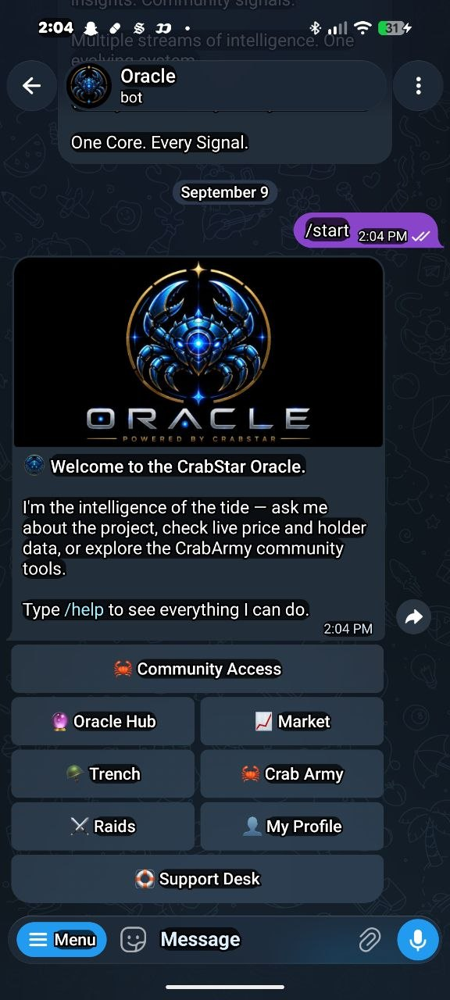
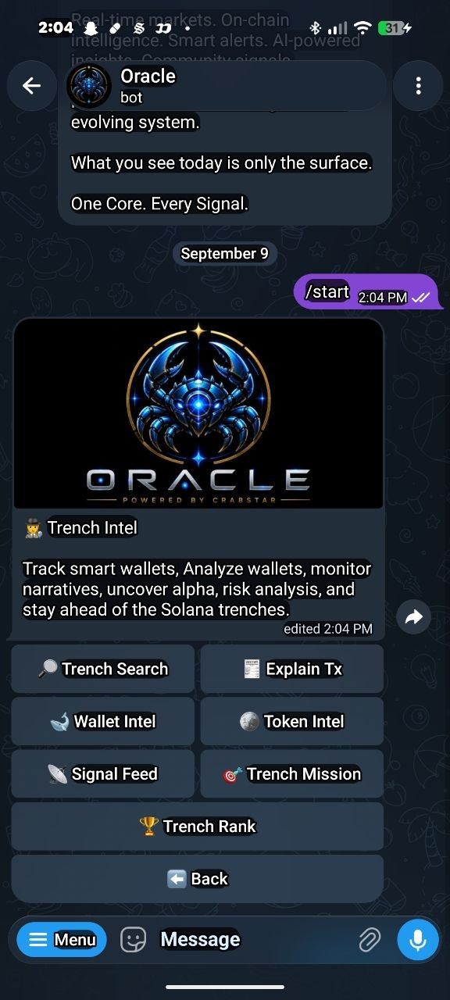
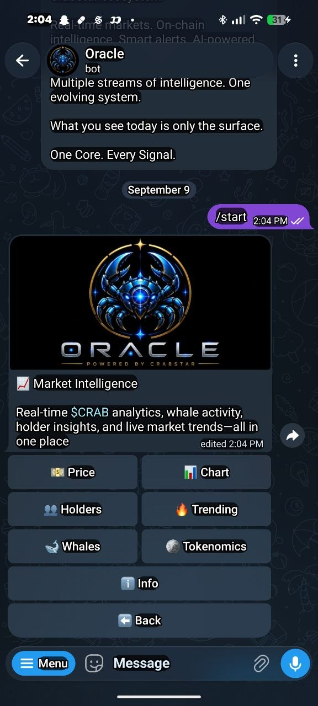
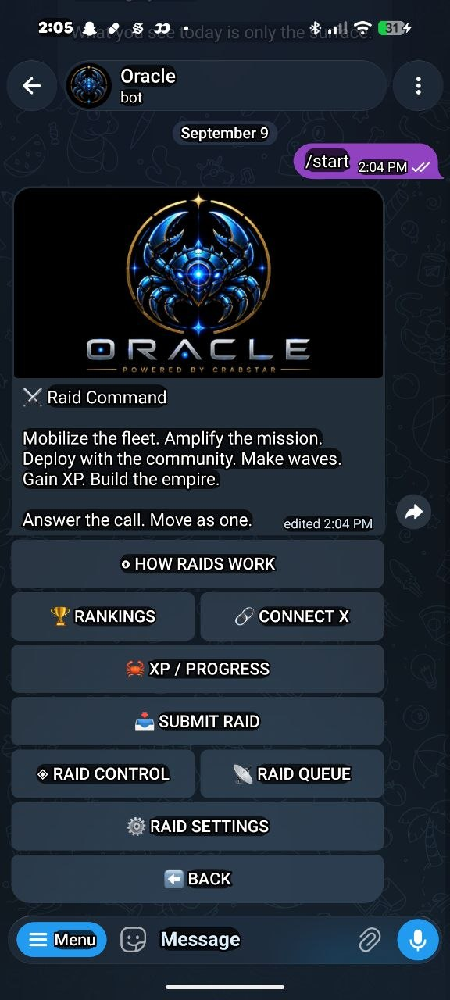
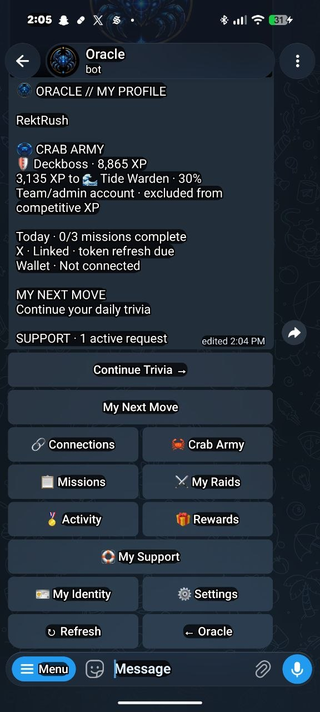
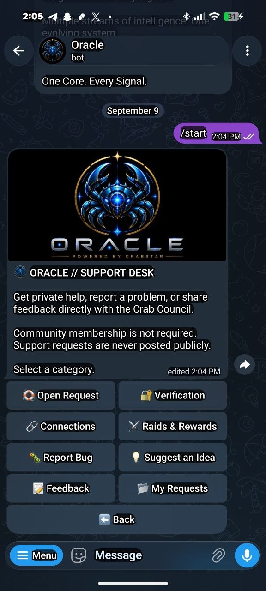
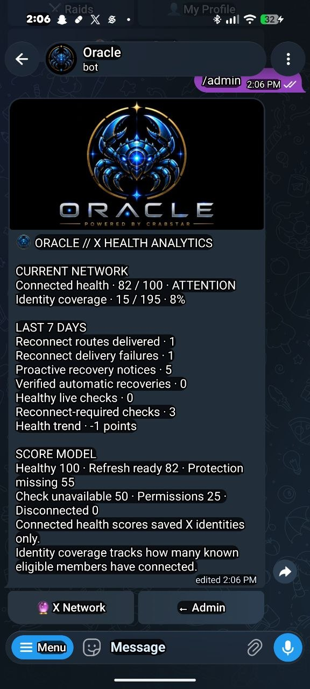
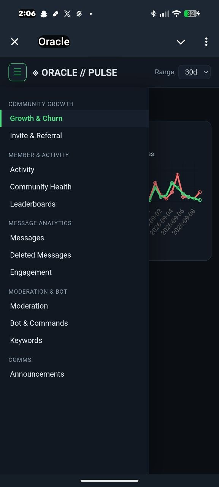
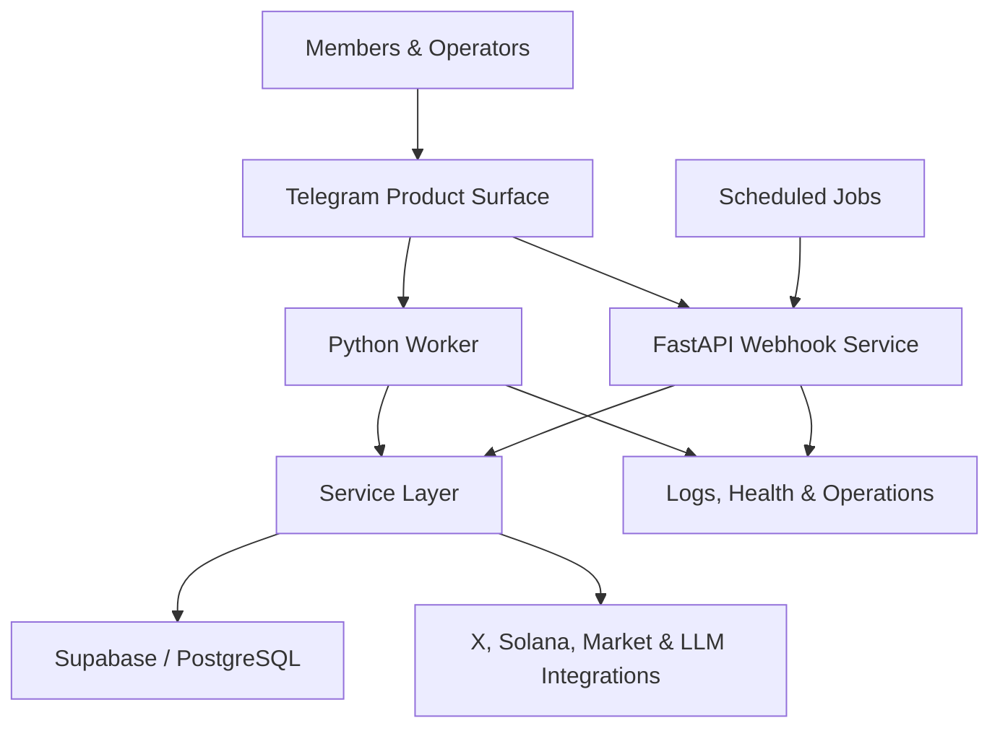
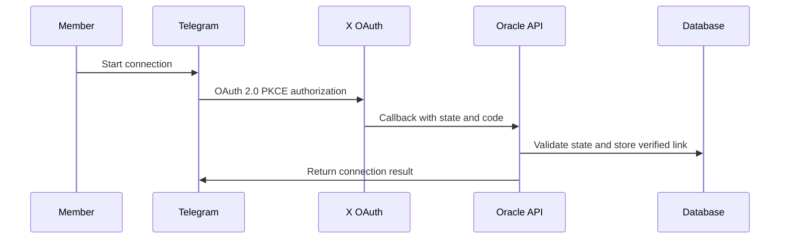

# ORACLE

### Identity, Intelligence & Ecosystem Operations

**A modular platform connecting persistent identity, intelligence and community operations for CrabStar**

[Product Overview](#product-overview) · [Architecture](#system-architecture) · [Engineering](#engineering-decisions) · [My Role](#my-role)

---

> **Public engineering case study:** Product scope, selected interface examples and high-level engineering decisions. Application source and operational documentation remain private.

## Executive summary

Oracle is an AI-assisted intelligence and operations platform designed to turn a fragmented community workflow into one connected system.

It combines a Telegram product surface with identity, profiles, participation infrastructure, support workflows, market and Solana intelligence, administrative controls, scheduled automation, and production observability. Instead of treating each feature as an isolated bot command, Oracle coordinates them through shared services and persistent data.

Oracle's repository contains a Telegram application, identity service, platform API, analytics surface and reusable domain services. Historical release records describe deployed services, but this case study is not a fresh live-service audit. Current cross-product identity and integration work is tracked separately from existing implementation.

## Product overview

Oracle was built around a practical problem: a growing online community cannot reliably run identity, support, participation, intelligence, moderation, and administration through disconnected bots and manual spreadsheets.

Oracle provides one operating layer for:

| Product surface | What it does |
|---|---|
| AI intelligence | Answers ecosystem and market questions with request-gated live context and explicit unavailable states |
| Identity | Persistent profiles and verified connections; progressive Google/Apple ecosystem entry is under development |
| Member profiles | Connects identity, participation, XP, rank, streaks, referrals, rewards, and receipts |
| Participation | Manages raids, missions, verification states, leaderboards, alerts, and settlement receipts |
| Solana tools | Explains public transactions, inspects public wallets, and surfaces token and authority data |
| Community access | Guides entry checks, assisted-entry requests, retries, overrides, and recovery workflows |
| Support and moderation | Routes member issues to an operational command surface with status and audit context |
| Administration | Gives the team diagnostic, review, configuration, and member-support controls |
| Analytics dashboard | Provides 30-day and configurable views across growth, churn, referrals, activity, health, engagement, moderation, commands, keywords, and communications |
| Automation | Runs scheduled activity processing, notifications, refresh jobs, and bounded community nudges |

## Beyond Telegram

Oracle is evolving into the shared identity, intelligence and operating layer consumed by multiple CrabStar products.

| Product | Relationship |
| --- | --- |
| Project Q | Owns campaign economics and consumes Oracle-verified identity; accepted campaign contribution can feed permanent progression |
| Universe | Unified application experience consuming Oracle and Q |
| Bagwork | Contribution and impact platform with shared identity and economic integrations under development |
| Shadow | Separate DeFi intelligence and agentic infrastructure; future integration preserves independent research and trading boundaries |

The approved identity direction begins with Google or Apple ecosystem entry, then adds Telegram/X connections and a verified Solana wallet as required. Existing members should claim their canonical profiles while preserving history and reputation.

These expanded authentication and integration paths are active development, not a claim that the complete journey is currently live.

## Product in action

These existing interface examples illustrate the Telegram product and its operational surfaces. They are historical product examples rather than proof of the latest deployment or completed cross-product integrations.

<table>
  <tr>
    <td width="33%" valign="top"> <strong>Unified product hub</strong> One entry point for community access, intelligence, markets, raids, profiles, and support.</td>
    <td width="33%" valign="top"> <strong>Trench intelligence</strong> Wallet, token, transaction, signal, mission, and ranking workflows organized behind one interface.</td>
    <td width="33%" valign="top"> <strong>Market intelligence</strong> Price, chart, holder, whale, trend, and tokenomics views backed by live-data integrations.</td>
  </tr>
  <tr>
    <td width="33%" valign="top"> <strong>Participation operations</strong> Raid education, X connection, XP, submissions, review controls, queues, and configuration.</td>
    <td width="33%" valign="top"> <strong>Persistent member profile</strong> Identity, XP, rank, missions, activity, rewards, support state, and next actions in one view.</td>
    <td width="33%" valign="top"> <strong>Support infrastructure</strong> Private, categorized requests for access, verification, connections, raids, rewards, bugs, and feedback.</td>
  </tr>
</table>

   
  <strong>Operational health analytics</strong> 
  Aggregate connection health, recovery activity, coverage, and diagnostic scoring for administrators.

   
  <strong>Oracle Pulse analytics dashboard</strong> 
  A dedicated Mini App surface for growth and churn, invite and referral performance, activity, community health, leaderboards, message analytics, engagement, moderation, bot usage, keywords, and announcements.

## System architecture

### High-level service design

- **Python Telegram worker** for interactive member and administrative flows.
- **FastAPI/ASGI webhook service** for OAuth callbacks, provider events, health checks, and scheduled endpoints.
- **Supabase/PostgreSQL** for identity links, operational state, participation records, and durable workflow data.
- **Scheduled Render jobs** for recurring processing and automation.
- **External integrations** for X identity, Solana RPC/data, market context, and LLM-assisted intelligence.
- **Separate production and development branches/services**, with explicit safeguards around shared Telegram polling.
- **Health, diagnostic, and rollback procedures** used during release work.

## Representative workflows

### 1. X identity connection

The flow uses OAuth 2.0 PKCE, short-lived state, server-side token handling, and a persistent one-profile identity relationship. Authentication failures are surfaced without leaking provider payloads or credentials.

### 2. Intelligence request

Oracle classifies the request before calling a live provider. General education stays local; current-price, token, wallet, or transaction questions call only the relevant data path.

Returned facts carry source/freshness context where available. Missing or incomplete provider data is reported as unavailable rather than estimated. Provider failures are isolated so one degraded integration does not silently corrupt the rest of the response.

### 3. Participation settlement

Participation moves through explicit states rather than granting rewards directly from a button press. The system records the claim, applies eligibility and replay rules, settles the result, updates durable state, and sends an Oracle-branded receipt showing the XP outcome.

This design separates **interaction**, **verification**, **settlement**, and **communication** so each stage can be audited and recovered independently.

## Engineering decisions

### Fail visibly, not deceptively

Oracle distinguishes confirmed facts from unavailable, partial, stale, or unsupported data. For example:

- Failed Solana executions are not presented as completed transfers.
- Unknown fees and non-finite values remain unknown.
- Wallet coverage is bounded and labeled rather than described as complete.
- Mint and freeze authority data distinguishes “unavailable” from “disabled.”
- Live market values are never invented when a provider is unavailable.

### Bound cost and provider load

Live calls are request-gated, cached where appropriate, and retried only for narrowly defined transient failures. Expensive verification paths are separated from lower-cost participation accounting so the product can scale without pretending every action can be independently re-proven at unlimited volume.

### Design for operational recovery

Critical workflows use explicit states, idempotency/replay protection where required, safe retry boundaries, diagnostic context, and rollback procedures. Read retries are deliberately narrower than write behavior to avoid duplicating state-changing operations.

### Keep private data and secrets server-side

OAuth credentials, API keys, member data, private endpoints, and production implementation remain outside this public repository. Public Solana analysis uses public-chain data and never requests seed phrases, private keys, or recovery words.

### Treat deployment as part of the product

Oracle separates development and production services, gates deployment on checks, exposes health endpoints, and documents live verification steps. A merge or successful unit test is not treated as proof that every external provider and Telegram delivery path is healthy in production.

## Quality and verification

The private repository includes automated tests around high-risk boundaries such as:

- OAuth state binding and sanitized failure handling
- transaction normalization and failed-transaction semantics
- wallet valuation and incomplete coverage
- provider fallbacks and unavailable states
- profiles, ranks, missions, signals, and participation flows
- handler behavior with mocked network boundaries

Release checks add live-provider comparisons, successful/failed transaction exercises, Telegram navigation, startup health, log inspection, and rollback readiness.

## My role

**Thomas Phillips — Co-Founder of CrabStar & Technical Product Builder**

I own Oracle from problem definition through production operations:

- Product strategy, workflow design, and user experience
- System architecture and data-flow decisions
- AI-agent-assisted implementation and review
- API, OAuth, database, and infrastructure integration
- Testing strategy, release checks, debugging, and production iteration
- Cost, reliability, security, and operational tradeoffs

My background in carpentry, contracting and commercial fishing shapes the same ownership model: understand constraints, make the decisions, deliver useful work and remain accountable for the outcome.

## Technology

`Python` · `FastAPI` · `Uvicorn` · `Telegram Bot API` · `Supabase` · `PostgreSQL` · `OAuth 2.0 PKCE` · `Solana RPC` · `REST APIs` · `Render` · `GitHub` · `Scheduled Workers` · `LLM Integrations`

## Current status

**Reviewed October 10, 2026.** The private default branch represents substantial Telegram, intelligence, participation, support, analytics and API infrastructure. Open development work expands progressive authentication, canonical reputation/access, Q integrations and Bagwork profile experiences.

Historical deployment records and interface examples are evidence of prior work. They do not establish current live health or full-system verification. New capabilities are considered separately as implemented, under review, deployed or verified.

Long-term direction: shared identity continuity, reusable intelligence and support, cross-product contribution history and accountable ecosystem operations.

## Why this repository is public

Oracle serves as evidence of end-to-end product ownership while protecting the production system and its users. This documentation exposes the product thinking, architecture, engineering tradeoffs, and verification discipline—not sensitive code or configuration.

Explore the [ecosystem engineering portfolio](https://github.com/darealrektrush) or contact **Thomas Phillips** through [X / Trench Intel](https://x.com/darealrektrush).
