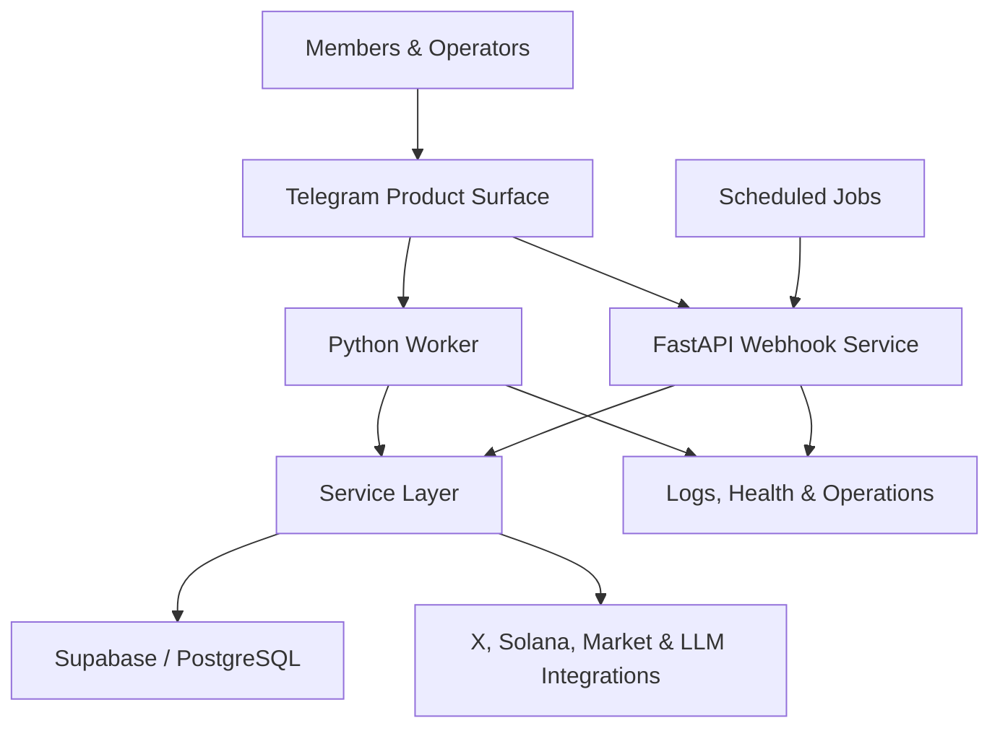
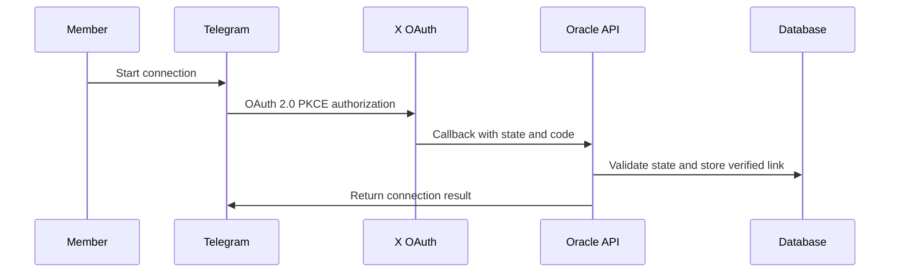

# ORACLE

### AI Intelligence, Identity & Community Operations Infrastructure

**A production-deployed system built and operated for the CrabStar ecosystem**

[Product Overview](#product-overview) · [Architecture](#system-architecture) · [Engineering](#engineering-decisions) · [My Role](#my-role)

---

> **Case-study repository:** This repository documents a private production system. It intentionally contains no application source code, credentials, private endpoints, member data, or security-sensitive implementation details.

## Executive summary

Oracle is an AI-assisted intelligence and operations platform designed to turn a fragmented community workflow into one connected system.

It combines a Telegram product surface with identity, profiles, participation infrastructure, support workflows, market and Solana intelligence, administrative controls, scheduled automation, and production observability. Instead of treating each feature as an isolated bot command, Oracle coordinates them through shared services and persistent data.

The production worker, webhook service, operations service, and scheduled jobs are deployed on Render. Individual flows have regression and release checks; complete-system production verification is an ongoing operational process.

## Product overview

Oracle was built around a practical problem: a growing online community cannot reliably run identity, support, participation, intelligence, moderation, and administration through disconnected bots and manual spreadsheets.

Oracle provides one operating layer for:

| Product surface | What it does |
|---|---|
| AI intelligence | Answers ecosystem and market questions with request-gated live context and explicit unavailable states |
| Identity | Links Telegram and X accounts through OAuth 2.0 PKCE with short-lived state |
| Member profiles | Connects identity, participation, XP, rank, streaks, referrals, rewards, and receipts |
| Participation | Manages raids, missions, verification states, leaderboards, alerts, and settlement receipts |
| Solana tools | Explains public transactions, inspects public wallets, and surfaces token and authority data |
| Community access | Guides entry checks, assisted-entry requests, retries, overrides, and recovery workflows |
| Support and moderation | Routes member issues to an operational command surface with status and audit context |
| Administration | Gives the team diagnostic, review, configuration, and member-support controls |
| Automation | Runs scheduled activity processing, notifications, refresh jobs, and bounded community nudges |

## System architecture

### Production topology

- **Python Telegram worker** for interactive member and administrative flows.
- **FastAPI/ASGI webhook service** for OAuth callbacks, provider events, health checks, and scheduled endpoints.
- **Supabase/PostgreSQL** for identity links, operational state, participation records, and durable workflow data.
- **Scheduled Render jobs** for recurring processing and automation.
- **External integrations** for X identity, Solana RPC/data, market context, and LLM-assisted intelligence.
- **Separate production and development branches/services**, with explicit safeguards around shared Telegram polling.
- **Health, diagnostic, and rollback procedures** used during release work.

## Representative workflows

### 1. X identity connection

The flow uses OAuth 2.0 PKCE, short-lived state, server-side token handling, and a persistent one-profile identity relationship. Authentication failures are surfaced without leaking provider payloads or credentials.

### 2. Intelligence request

Oracle classifies the request before calling a live provider. General education stays local; current-price, token, wallet, or transaction questions call only the relevant data path.

Returned facts carry source/freshness context where available. Missing or incomplete provider data is reported as unavailable rather than estimated. Provider failures are isolated so one degraded integration does not silently corrupt the rest of the response.

### 3. Participation settlement

Participation moves through explicit states rather than granting rewards directly from a button press. The system records the claim, applies eligibility and replay rules, settles the result, updates durable state, and sends an Oracle-branded receipt showing the XP outcome.

This design separates **interaction**, **verification**, **settlement**, and **communication** so each stage can be audited and recovered independently.

## Engineering decisions

### Fail visibly, not deceptively

Oracle distinguishes confirmed facts from unavailable, partial, stale, or unsupported data. For example:

- Failed Solana executions are not presented as completed transfers.
- Unknown fees and non-finite values remain unknown.
- Wallet coverage is bounded and labeled rather than described as complete.
- Mint and freeze authority data distinguishes “unavailable” from “disabled.”
- Live market values are never invented when a provider is unavailable.

### Bound cost and provider load

Live calls are request-gated, cached where appropriate, and retried only for narrowly defined transient failures. Expensive verification paths are separated from lower-cost participation accounting so the product can scale without pretending every action can be independently re-proven at unlimited volume.

### Design for operational recovery

Critical workflows use explicit states, idempotency/replay protection where required, safe retry boundaries, diagnostic context, and rollback procedures. Read retries are deliberately narrower than write behavior to avoid duplicating state-changing operations.

### Keep private data and secrets server-side

OAuth credentials, API keys, member data, private endpoints, and production implementation remain outside this public repository. Public Solana analysis uses public-chain data and never requests seed phrases, private keys, or recovery words.

### Treat deployment as part of the product

Oracle separates development and production services, gates deployment on checks, exposes health endpoints, and documents live verification steps. A merge or successful unit test is not treated as proof that every external provider and Telegram delivery path is healthy in production.

## Quality and verification

The private repository includes automated tests around high-risk boundaries such as:

- OAuth state binding and sanitized failure handling
- transaction normalization and failed-transaction semantics
- wallet valuation and incomplete coverage
- provider fallbacks and unavailable states
- profiles, ranks, missions, signals, and participation flows
- handler behavior with mocked network boundaries

Release checks add live-provider comparisons, successful/failed transaction exercises, Telegram navigation, startup health, log inspection, and rollback readiness.

## My role

**Thomas Phillips — Founder & Technical Product Builder**

I own Oracle from problem definition through production operations:

- Product strategy, workflow design, and user experience
- System architecture and data-flow decisions
- AI-agent-assisted implementation and review
- API, OAuth, database, and infrastructure integration
- Testing strategy, release checks, debugging, and production iteration
- Cost, reliability, security, and operational tradeoffs

My software career is newer than a conventional senior-engineering path. My ownership background is not: before building software products, I spent roughly ten years running an owner-operated contracting business. Oracle reflects that same operating model—define the problem, make the decisions, ship the work, and remain accountable for the outcome.

## Technology

`Python` · `FastAPI` · `Uvicorn` · `Telegram Bot API` · `Supabase` · `PostgreSQL` · `OAuth 2.0 PKCE` · `Solana RPC` · `REST APIs` · `Render` · `GitHub` · `Scheduled Workers` · `LLM Integrations`

## Current status

| Area | Status |
|---|---|
| Production worker | Deployed |
| Webhook/API service | Deployed |
| Scheduled jobs | Deployed |
| Database-backed workflows | Implemented and exercised |
| Automated regression coverage | Active |
| Full-system production verification | Ongoing |
| Public source release | Not planned; source remains private |

## Why this repository is public

Oracle serves as evidence of end-to-end product ownership while protecting the production system and its users. This documentation exposes the product thinking, architecture, engineering tradeoffs, and verification discipline—not sensitive code or configuration.

For a technical walkthrough or interview discussion, contact **Thomas Phillips** through [GitHub](https://github.com/darealrektrush) or visit [CrabStar](https://crabstarcoinsol.online).
